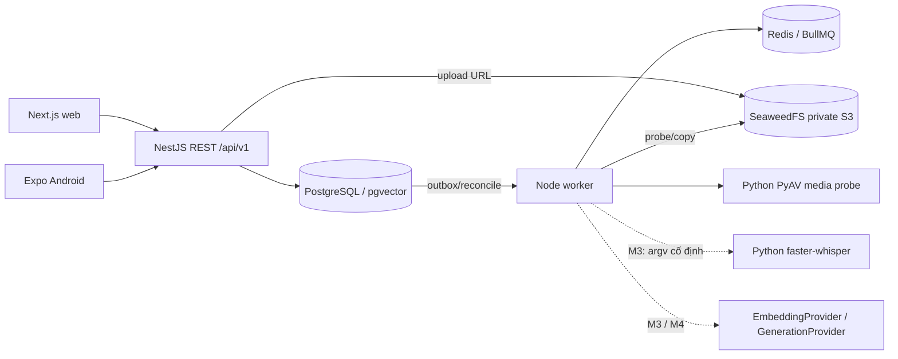

# Kiến trúc

Đường liền biểu thị tích hợp hiện có; đường đứt là công việc chưa hoàn thành. API là modular monolith; worker scale riêng. TypeORM quản lý kết nối/migration, truy vấn tham số hóa; `synchronize=false`. Đã chạy pgvector 0.8.6 trong Compose, chưa có bảng embedding hoặc retrieval.

`packages/api-client/src/schema.d.ts` sinh từ Swagger/OpenAPI. Hai client dùng session client chung, có refresh single-flight, retry tối đa một lần, epoch chặn response cũ và hàng đợi thao tác SecureStore để tránh ghi token cũ sau logout. React DOM và native có UI riêng.

Web không ghi token vào localStorage/sessionStorage. Refresh qua cookie HttpOnly/Secure/SameSite=Strict, endpoint web yêu cầu Origin chính xác và header CSRF buộc preflight. Mobile truyền refresh trong body, giữ ở SecureStore; route mobile từ chối request mang Origin trình duyệt. CORS allowlist không cấp quyền truy cập nghiệp vụ.

Mọi request được gán request_id mới. Lỗi trả code/message/request_id; input validation trả 422. Không bật query/body/token logging. Rate limit auth hiện ở bộ nhớ của một API instance, cần chuyển Redis hoặc gateway được cấu hình tin cậy trước khi scale API.

Pipeline media và outbox đã tích hợp backend và web upload/player; Android và chức năng AI chưa tích hợp. ASR CLI đã chạy riêng local; không thay cho pipeline AI có version. Không có mock provider được gắn nhãn là model thật. Phụ đề là dữ liệu không đáng tin; parser chỉ kiểm tra timestamp/nội dung, không thực thi chỉ dẫn trong nguồn. Xem ADR 0002 về media bất biến, khóa course và giới hạn worker.
