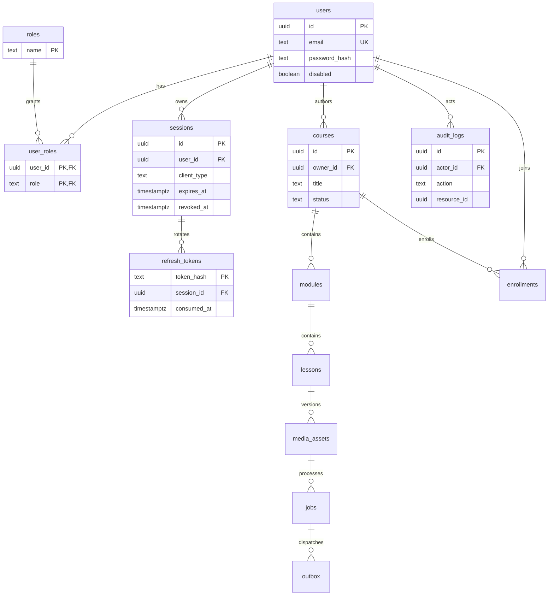

# Dữ liệu và ERD

## Schema đã triển khai

UUID sinh ở server; timestamp `timestamptz`. Email normalize lowercase, unique; FK cho role/session/owner/actor. Refresh token chỉ lưu SHA-256 (token ngẫu nhiên 256-bit), mật khẩu dùng scrypt với salt ngẫu nhiên. Giữ hash token đã dùng để phát hiện replay và thu hồi session.

Migration `Foundation1790035200000` tạo schema. Lần chạy lại không thay đổi dữ liệu. Không có tự động down migration xóa bảng; rollback dữ liệu cần kế hoạch riêng. `audit_logs.resource_id` hiện là UUID đa hình, action khóa tài khoản chỉ nhận ID đã được xác minh tồn tại trong transaction.

## Migration media và schema còn lại

Migration `Media1790035201000` đã bổ sung modules/lessons/enrollments/media_assets/jobs/outbox và courses.structure_locked_at. Unique enrollment(user,course), module/lesson position và job_key; composite FK active_media_id/id bảo đảm media thuộc đúng lesson. READY yêu cầu duration/playback key/byte hợp lệ. Course ID được dùng làm phiên bản cấu trúc; chưa có thao tác clone version. Test upgrade giữ fixture của schema nền tảng.

M3/M4 chưa tạo transcript_versions/segments/index_versions/chunks/embeddings/summaries/conversations/messages/citations/ai_usage. M5 chưa tạo quiz_versions/questions/options/attempts/attempt_answers/watch_events/lesson_progress/resume_state. Feedback và vận hành bổ sung sau.

Mỗi migration mới phải test từ DB trống và upgrade từ phiên bản trước. Unique theo user/event_id, user/media_version, lesson/transcript_version là gate khi có các bảng tương ứng. Không lưu binary video trong DB; chưa có tính toán progress/completion.
